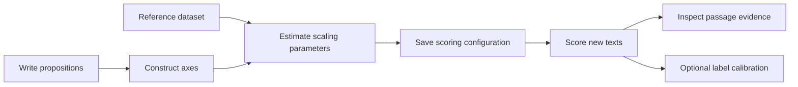

# propaxis

**Proposition-based text measurement and classification.**

[](https://github.com/atomashevic/propaxis/actions/workflows/tests.yml)
[](https://www.python.org/)
[](LICENSE)

Write the claims you want to measure. Define a meaningful contrast. Use their sentence embeddings to construct an axis, score new texts, and inspect the passages behind each score.

`propaxis` turns researcher-defined propositions into reusable text measures. It uses pretrained models locally and does not update their weights. You can measure one component, combine several components, add an entailment check, and fit a binary decision threshold on labeled calibration data.

**Version 0.1.0** is the first public implementation. Install it from GitHub; it has not been published to PyPI. The planned R interface is **propRaxis**.

## What you can do

- Define components using positive and contrast propositions.
- Construct axes from differences between average sentence embeddings.
- Estimate scaling parameters on a reference dataset and reuse them for new documents.
- Score sentences or overlapping passages within longer documents.
- Combine components using a geometric mean, arithmetic mean, or minimum.
- Add an optional local entailment model to assess support for written claims.
- Inspect selected passages, component scores, and matched hypotheses.
- Fit a binary classification threshold and evaluate it on separate test data.
- Edit propositions interactively in a Jupyter notebook.
- Save the complete scoring configuration as JSON.



## Install

With [uv](https://docs.astral.sh/uv/):

```bash
uv venv
uv pip install 'propaxis[models,notebook] @ git+https://github.com/atomashevic/propaxis.git@v0.1.0'
```

Or with pip in your preferred environment:

```bash
python -m pip install 'propaxis[models,notebook] @ git+https://github.com/atomashevic/propaxis.git@v0.1.0'
```

Use Python 3.10 or later. The base library requires only NumPy. `models` adds PyTorch and Transformers; `notebook` adds the interactive editor and pandas. Activate the environment before running Python, or use `uv run --no-sync python` inside it.

For a CPU-only PyTorch installation, install the appropriate wheel first:

```bash
uv pip install torch --index-url https://download.pytorch.org/whl/cpu
uv pip install 'propaxis[models,notebook] @ git+https://github.com/atomashevic/propaxis.git@v0.1.0'
```

GPU users should install a PyTorch build compatible with their system. The library accepts `device="cuda"` or `device="mps"` through the model constructors; availability and numerical behavior depend on the installed PyTorch build. CPU is the default and the integration-tested path for this release.

Models download when first used and are then cached by Hugging Face. Weights are not included in the Python distribution. You can download them explicitly before a session:

```python
from propaxis import download_models

download_models("e5-small-v2")
# Optional, substantially larger download:
# download_models("e5-large-v2", claim_check=True)
```

After downloading, inference runs on your machine. Texts are not sent to a hosted inference service. Use `HF_HOME` to choose a model-cache directory, and `local_files_only=True` to require cached models.

## Quick start

This example measures support for public transit funding. It is a tutorial, not a validated policy-attitude instrument.

### 1. Write the propositions

Each component has two poles. `positive` expresses more of the target construct; `contrast` expresses a substantive alternative. “Positive” refers to the direction of the scale, not positive sentiment.

```python
from propaxis import Component, Construct, Encoder

transit = Component(
    "transit_support",
    positive=[
        "The city should invest more in public transportation.",
        "Expanding bus and rail services should be a budget priority.",
        "Affordable and frequent public transit deserves public funding.",
    ],
    contrast=[
        "The city should reduce spending on public transportation.",
        "Expanding bus and rail services is not a budget priority.",
        "Public transit should receive less public funding.",
    ],
)
```

Write complete claims. Cover several expressions of the concept without repeating the same sentence. Keep topic, grammatical form, and specificity reasonably comparable across poles. Contrast propositions should address the same conceptual question: unrelated sentences do not define an interpretable opposite.

The poles may contain different numbers of propositions. Sentences do not need to be paired by position. The library rejects empty poles, duplicate sentences within a pole, and identical sentences on both poles. These checks catch input problems; they do not establish measurement validity.

### 2. Specify how documents are scored

```python
construct = Construct(
    "transit_stance",
    components=[transit],
    window=1,  # sentences in each passage
    top_k=1,  # score the strongest passage in each document
)

construct.save("transit_construct.json")
```

Use `window=3` when a claim needs nearby context. For longer documents, `top_k=8` averages the eight strongest passages, or all available passages if there are fewer than eight. `top_k=None` averages every passage. These choices define different quantities: strongest expression, intensity among selected passages, or average passage intensity.

Sentences longer than `max_words=60` are divided into shorter segments before passages are formed. The included sentence splitter uses punctuation; abbreviations and some languages may require preprocessing. Models also have token limits, so unusually long passages can be truncated.

### 3. Choose a reference dataset

The reference dataset supplies the means, standard deviations, and activation scales used throughout scoring. It does not need labels. Choose texts representative of the language, genre, length, and range of expression you intend to study.

```python
reference_texts = [
    "We should add bus routes to underserved neighborhoods.",
    "I support a larger budget for trains and buses.",
    "Affordable transit makes it easier for people to get to work.",
    "The council should fund more frequent bus services.",
    "Our transport budget should focus on maintaining roads.",
    "We cannot afford another public rail expansion.",
    "Bus subsidies should be reduced next year.",
    "Public transportation already receives too much funding.",
    "The council will meet on Tuesday to discuss the budget.",
    "The transport committee published its annual report.",
    "Residents disagree about the planned bus route.",
    "The city is reviewing several transport proposals.",
]

instrument = construct.fit(
    reference_texts,
    encoder=Encoder("e5-small-v2"),
)
```

`fit()` constructs the axes and estimates scaling parameters. It does **not** fine-tune the neural model. Three documents are the technical minimum; the small example above is for demonstration. Research applications need a larger, varied reference dataset and checks that the results are stable under reasonable reference choices.

The same model and preprocessing encode propositions and document passages. E5-small is the smaller default. E5-large is available as `Encoder("e5-large-v2")`; neither is a universal best model for a new construct. Both supported E5 models are intended for English.

### 4. Score new documents

```python
result = instrument.score(
    [
        "We need more frequent buses, and the city should pay for them.",
        "The city should stop subsidizing public transportation.",
    ],
    ids=["statement_1", "statement_2"],
)

print(result.to_pandas()[["id", "score", "transit_support_score"]])
print(result.evidence[0])
```

`score` is standardized relative to the reference dataset. Higher values indicate stronger expression under the specified construct. It is not a class probability or the proportion of a document belonging to a class.

`result.scores` is a list of ordinary dictionaries; pandas is optional. `result.evidence` contains the selected passages and their component projections. New documents never change the saved scaling parameters. A document receives the same score whether submitted alone or as part of a batch, apart from possible neural floating-point differences across devices or batch shapes.

Blank or missing texts are rejected rather than converted into text such as `"nan"`. Input order is preserved, and user-supplied IDs must be unique strings.

### 5. Save and reuse the instrument

```python
from propaxis import Instrument

instrument.save("transit_instrument.json")

restored = Instrument.load("transit_instrument.json", local_files_only=True)
new_result = restored.score("The next budget should expand bus services.")
```

The saved file includes propositions, hypotheses, axes, scaling parameters, exact resolved model revisions, a reference-dataset hash, and a configuration identifier. It excludes raw reference texts and model weights. Loading checks the file's checksum and model configuration. A checksum detects accidental changes; it is not a digital signature.

Keep this file with your analysis code and record how the reference dataset was constructed. To use another machine offline, also provision its Python dependencies and the recorded Hugging Face model snapshots. A JSON instrument alone does not include those dependencies or weights.

## Interactive construction in Jupyter

```python
from IPython.display import display
from propaxis.notebook import construct_editor

editor = construct_editor(construct)  # omit the argument to start an empty form
display(editor)
```

The form lets you add components, edit positive and contrast propositions, specify entailment hypotheses, and select passage and aggregation settings. **Validate and preview** checks the specification and displays its JSON. It loads no models and performs no inference.

After editing, run:

```python
edited_construct = editor.build()
edited_construct.save("edited_construct.json")
```

The returned object uses the current form values. Fit it to the reference dataset to construct the new axes and scaling parameters. Changing the propositions creates a new measure, so existing classification thresholds must be estimated again.

See [the guided notebook](examples/construct_a_measure.ipynb) for the full workflow.
If you need a notebook frontend, install `jupyterlab` and `ipykernel` in the same environment and run `jupyter lab examples/construct_a_measure.ipynb` from a repository checkout.

## Combine several components

A construct may require more than one kind of evidence. For example, the included populism specification combines people-sovereignty claims and elite-obstruction claims:

```python
from propaxis.presets import populism

construct = populism()

for component in construct.components:
    print(component.name, component.description)
    print(component.positive[0])
    print(component.contrast[0])
```

This specification contains forty propositions and ten entailment hypotheses from the Populism Axis project. It uses three-sentence passages, a geometric mean across the two components, and top-eight averaging within documents. Fit it on your own reference dataset:

```python
# reference_speeches is your sequence of representative speech texts.
instrument = construct.fit(
    reference_speeches,
    encoder=Encoder("e5-large-v2"),
)
```

The preset supplies the written construct and aggregation settings. It does not include benchmark data or fitted research parameters, and this package's output should not be presented as a reproduction of the project's benchmark estimates.

Available combination rules:

| `combine` | Meaning |
| --- | --- |
| `"geometric_mean"` | Favors evidence across components, while allowing compensation between them. This is a soft conjunction, not logical AND. |
| `"mean"` | Allows strong evidence on one component to offset weaker evidence on another. |
| `"minimum"` | Uses the weakest component's activation. |

Every component receives its own score and selected passages. The composite score selects passages using the combined activation. Do not interpret a component score as the full construct, or force a conjunction when a label asks for only one component.

## Add an entailment check

Similarity to a proposition does not establish that a passage asserts it. An optional NLI model provides an additional score for support for explicit hypotheses:

```python
from propaxis import Entailment

instrument = construct.fit(
    reference_speeches,
    encoder=Encoder("e5-large-v2"),
    claim_check=Entailment(),  # facebook/bart-large-mnli
)
```

Provide `hypotheses=[...]` when creating each `Component` to specify the claims to check. If omitted, the positive propositions are used. Short, explicit hypotheses make the output easier to interpret.

The model evaluates the passages selected by the axis. Within each component it takes the largest entailment probability across hypotheses. It combines components using the construct's rule, then averages selected passages. The final score averages the standardized axis and NLI scores with equal weights. Both sets of scaling parameters are estimated on the reference dataset.

The check includes entailment, contradiction, and neutral logits in its softmax. Low support does not veto the axis score. NLI outputs are not calibrated probabilities of the research label, and quotation, negation, and attribution still need validation. BART is a larger and slower optional dependency than the default encoder.

## From scores to binary labels

Use a dedicated labeled calibration sample to choose a decision threshold. Evaluate that threshold on different test documents. Keep repeated speakers, authors, or documents in the same data partition.

```python
from propaxis import calibrate

# calibration_texts, calibration_labels, test_texts and test_labels are your data.
# Labels must be 0/1, with both classes present in each evaluation sample.
calibration_scores = instrument.score(calibration_texts)
classifier = calibrate(
    calibration_scores,
    calibration_labels,
    objective="balanced_accuracy",  # or "f1"
)

test_scores = instrument.score(test_texts)
predicted_labels = classifier.predict(test_scores)
metrics = classifier.evaluate(test_scores, test_labels)
classifier.save("classifier.json")
```

For one component, pass `column="sovereignty_score"` or another component column to `calibrate()`. You can fit a separate threshold per component for independent binary labels. There is no multiclass softmax or automatic probability calibration in v0.1.

Evaluation reports a confusion matrix, accuracy, balanced accuracy, precision, recall, F1, AUROC, and average precision. Thresholds are tied to the scoring configuration ID; predictions from a different fitted instrument are rejected. Reload a threshold with `BinaryClassifier.load(path)`.

## Inspect the construction

```python
diagnostics = instrument.diagnostics
print(diagnostics["axis_cosines"])
print(diagnostics["components"]["sovereignty"])
```

Diagnostics show each anchor's projection, the distance between the two anchor centroids, the minimum cosine between the original axis and axes formed after removing one proposition, and cosine similarities between component axes.

These checks help detect overlapping components and directions dominated by particular propositions. They do not replace human validation. Compare model scores with independent coding and include plausible negative examples, ordinary criticism, negation, quotations, and related constructs.

## Use an existing encoder

Pass your own encoding function when you already have a model or need another language:

```python
from propaxis import CallableEncoder

# my_encode(texts) returns an array with shape (number_of_texts, dimensions).
encoder = CallableEncoder(my_encode, name="my-model-and-preprocessing-v1")
instrument = construct.fit(reference_texts, encoder=encoder)
```

The function must use a fixed representation, return finite vectors, and apply the same preprocessing to propositions and passages. Give it a versioned name. Reloading an instrument built with a custom encoder requires supplying that same encoder explicitly. The library checks the identifier and dimensions; the caller is responsible for the actual implementation matching that identifier.

For a runnable example with **no model download**, clone the repository, install the base package, and run:

```bash
python examples/offline_demo.py
```

That example uses a deliberately simple word-count encoder to demonstrate the API. It is not a semantic model.

## Command line

```bash
propaxis download --encoder e5-small-v2
propaxis score transit_instrument.json documents.csv \
  --text-column text --id-column id --output scores.json --offline
```

The input CSV contains one document per row. The JSON output includes scores and text excerpts from the supplied documents, so treat it as part of your research data.

## Method and scope

For each component, propaxis normalizes the proposition embeddings and subtracts the mean contrast embedding from the mean positive embedding. The normalized difference defines the axis. It centers document embeddings using the reference dataset's mean, normalizes them, and projects them onto each axis. Projections are standardized using the reference means and standard deviations.

The activation is `softplus(z / temperature)²`, divided by its median in the reference dataset. Component activations are combined and aggregated over selected passages. The optional NLI stage supplies a second score on those passages. [The method guide](docs/method.md) gives the equations, assumptions, and differences from the original research implementation.

This is a measurement workflow, not a guarantee that any written label is valid. New propositions, reference populations, languages, models, or aggregation choices require evaluation. Comparisons across countries or genres also require evidence that scores have comparable meaning. Higher ranking accuracy alone does not establish that comparability.

## Documentation and development

- [Construct design](docs/constructs.md): write propositions, select contrasts, and choose reference data.
- [Method](docs/method.md): equations, score interpretation, and assumptions.
- [API](docs/api.md): public objects and methods.
- [Testing](docs/testing.md): automated and real-model checks.
- [Guided notebook](examples/construct_a_measure.ipynb): interactive construction and scoring.
- [Quick start script](examples/quickstart.py): a complete example with E5.
- [Contributing](CONTRIBUTING.md): development setup and change policy.

## Origin and license

The axis construction, passage selection, activation, and optional entailment workflow derive from Aleksandar Tomašević's Populism Axis research code. This library generalizes them to named components and user-defined propositions. See [provenance](docs/provenance.md) for the source version and implementation differences.

The code is distributed under the [MIT license](LICENSE). Pretrained models retain their own licenses and model-card requirements. No research corpus or pretrained weights are redistributed in the package.
